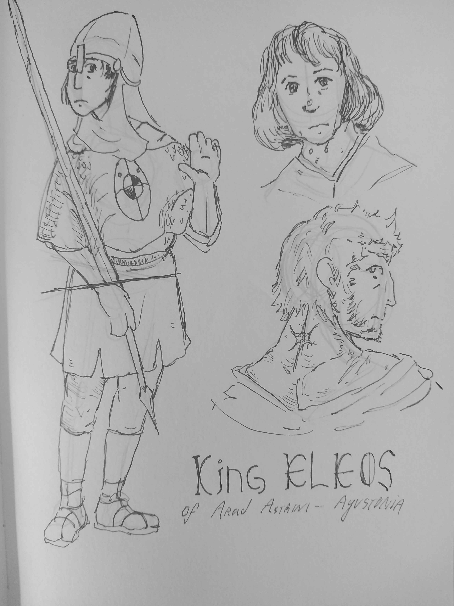

  
  King Eleos of Arad-Astrim, Agustonia
  

  Born in: 7608 2E, Island of Arad-Astrim 
  

    Death: 7753 2E 
    

      

Eleos was the first star-men and King of the Agustonian independent island of Arad-Astrim for most part of his life; He had the powers and respect of a Lutenno but wasn't named by the Emperors; Eleos was also a general and strategist on military affairs, a paladin of Tor, and astronomical mathematician and cartographer. His children and grandchildren followed the royal lineage of star-men after his death, with the Lux Nul (Black Star) as their Birthmark in the back of their necks.

